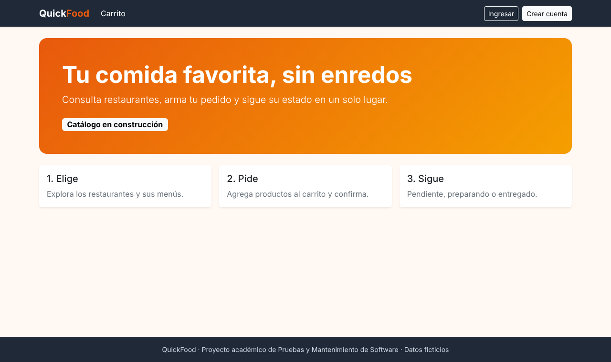
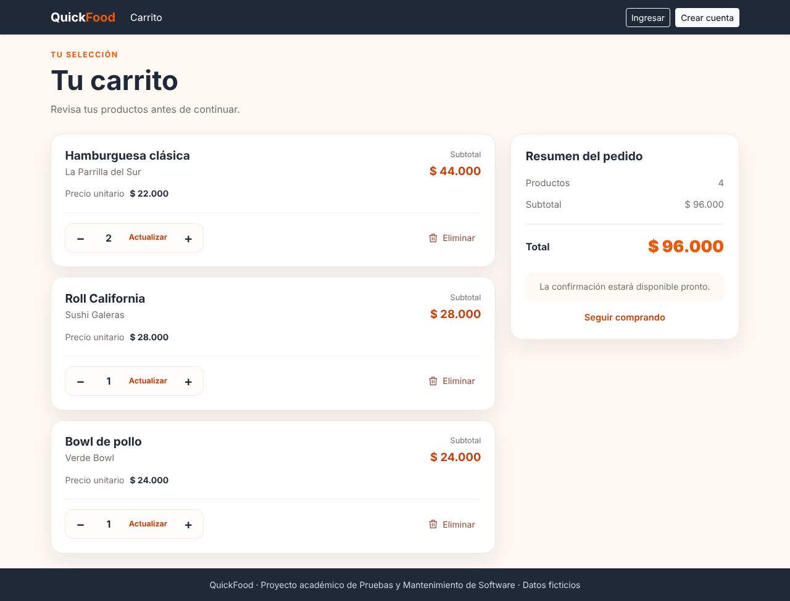
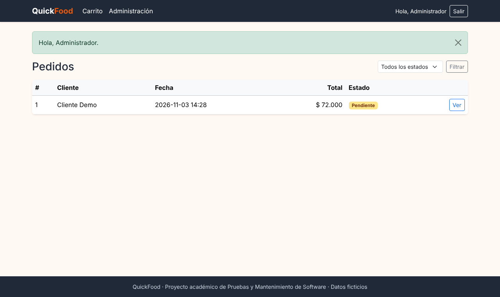
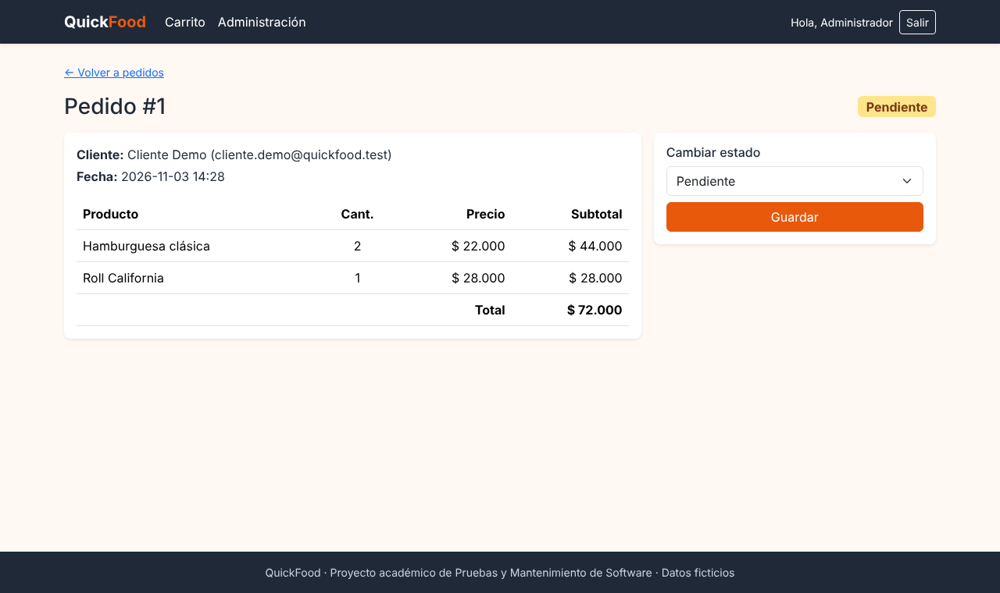
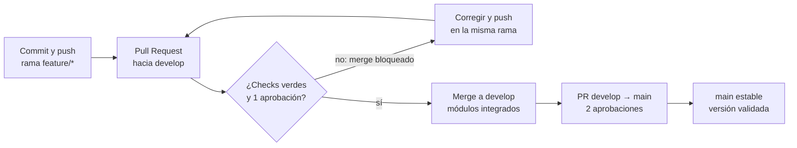
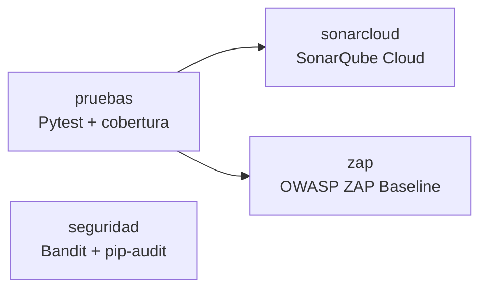
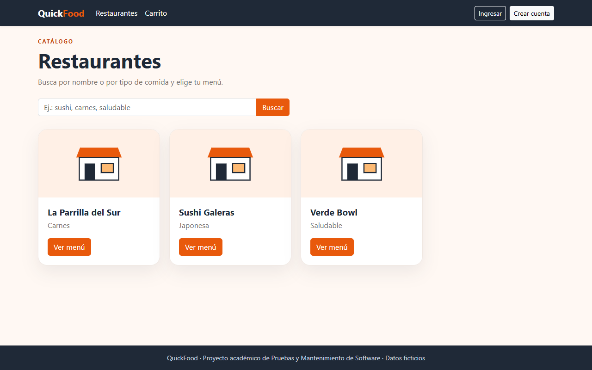
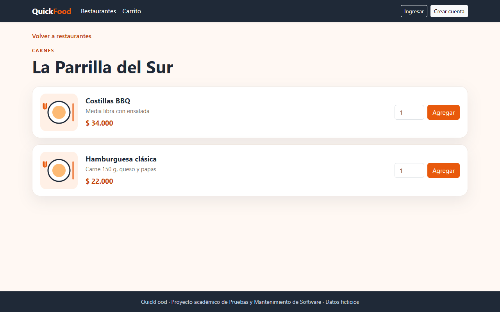

<div align="center">

# 🍔 QuickFood

### Pedidos de comida con un pipeline DevOps que detecta los errores antes de producción

[](https://github.com/dramirezdlp99/quickfood/actions/workflows/quality.yml)
[](https://sonarcloud.io/summary/new_code?id=dramirezdlp99_quickfood&branch=develop)
[](https://sonarcloud.io/summary/new_code?id=dramirezdlp99_quickfood&branch=develop)
[](https://sonarcloud.io/summary/new_code?id=dramirezdlp99_quickfood&branch=develop)




</div>

---

## 🎓 Información académica

| Dato | Detalle |
| --- | --- |
| **Universidad** | Universidad Cooperativa de Colombia · Sede Pasto |
| **Facultad** | Facultad de Ingeniería |
| **Programa** | Ingeniería de Software |
| **Asignatura** | Pruebas y Mantenimiento de Software |
| **Docente** | Gabriel Antonio Guerrero Arellano |
| **Periodo** | 2026-2 |

## 👥 Equipo

| Integrante | GitHub | Módulo | Responsabilidades |
| --- | --- | --- | --- |
| **Juan Felipe Mora Revelo** | [@Pipemora1324](https://github.com/Pipemora1324) | Restaurantes y catálogo | Inicio, listado de restaurantes, menús, búsqueda y sus pruebas |
| **Daniers Alexander Solarte Limas** | [@solartedaniers](https://github.com/solartedaniers) | Carrito y pedidos | Carrito, cálculo de totales en el servidor, validaciones, confirmación del pedido y sus pruebas |
| **David Fernando Ramírez de la Parra** | [@dramirezdlp99](https://github.com/dramirezdlp99) | Usuarios, administración e integración | Registro, inicio de sesión, roles, panel administrativo, repositorio, pipeline CI, SonarQube Cloud, reglas de ramas y OWASP ZAP |

> Los tres integrantes revisan los Pull Requests de los demás, ejecutan las pruebas y corrigen los defectos de su propio módulo.

---

## 📑 Contenido

1. [El proyecto](#-el-proyecto)
2. [Funcionalidades](#-funcionalidades)
3. [El enfoque DevOps](#-el-enfoque-devops)
4. [Herramientas de calidad y seguridad](#-herramientas-de-calidad-y-seguridad)
5. [Reglas de ramas](#-reglas-de-ramas)
6. [Resultados](#-resultados)
7. [Errores detectados antes de producción](#-errores-detectados-antes-de-producción)
8. [Decisiones de seguridad](#-decisiones-de-seguridad)
9. [Tecnologías y estructura](#-tecnologías-y-estructura)
10. [Ejecutar en local](#-ejecutar-en-local)
11. [Cómo contribuir](#-cómo-contribuir)
12. [Restaurantes y catálogo](#️-restaurantes-y-catálogo)

---

## 📌 El proyecto

**El problema.** En muchos restaurantes los pedidos llegan por WhatsApp, llamadas o mensajes y quedan repartidos en distintas conversaciones. Eso provoca errores en precios, cantidades, productos y en el estado de cada pedido.

**La solución.** QuickFood centraliza el catálogo y el registro de pedidos en una aplicación web: el cliente consulta restaurantes, arma su carrito y confirma el pedido; el administrador consulta los pedidos y actualiza su estado.

**El objetivo académico.** La aplicación es el medio; el centro del proyecto es el **proceso**. Ningún cambio llega a la rama principal sin pasar pruebas automáticas, análisis de calidad y seguridad, y la revisión de otro integrante. Así los errores se detectan cuando corregirlos es barato, y no cuando el usuario ya los sufre.

> Proyecto de alcance controlado: usa datos ficticios y no incluye pagos en línea, geolocalización ni restaurantes reales.

## ✨ Funcionalidades

| Módulo | Funcionalidad | Estado |
| --- | --- | --- |
| Usuarios | Registro, inicio y cierre de sesión con contraseñas en hash | ✅ Integrado |
| Usuarios | Roles cliente y administrador, rutas protegidas | ✅ Integrado |
| Administración | Lista de pedidos con filtro por estado, detalle y cambio de estado (pendiente → preparando → entregado) | ✅ Integrado |
| Carrito | Agregar, cambiar cantidades (1 a 20) y eliminar productos; totales calculados en el servidor con los precios de la base de datos | ✅ Integrado |
| Pedidos | Confirmar el carrito con token de un solo uso y total calculado en el servidor; "Mis pedidos" y detalle con su estado | ✅ Integrado |
| Catálogo | Listado de restaurantes, menús y búsqueda | ✅ Integrado |

<table>
  <tr>
    <td width="50%"><p align="center"><sub>Carrito con totales calculados en el servidor</sub></p></td>
    <td width="50%"><p align="center"><sub>Panel administrativo de pedidos</sub></p></td>
  </tr>
  <tr>
    <td colspan="2"><p align="center"><sub>Detalle del pedido y cambio de estado</sub></p></td>
  </tr>
</table>

---

## 🔁 El enfoque DevOps

Cada cambio viaja por el mismo camino. Si un check falla o falta la aprobación, el cambio vuelve a su autor; solo lo que pasa todo llega a `develop` y, con dos aprobaciones, a `main`.



En cada push y Pull Request, [GitHub Actions](.github/workflows/quality.yml) ejecuta cuatro trabajos:



`sonarcloud` y `zap` esperan a que `pruebas` termine bien: si el código no pasa sus pruebas, no se gasta tiempo analizándolo.

## 🛠️ Herramientas de calidad y seguridad

| Herramienta | Tipo | Qué detecta | Dónde se ve |
| --- | --- | --- | --- |
| **Pytest** | Dinámica | Que cada función y ruta haga lo esperado | Check `pruebas` |
| **pytest-cov** | Métrica | Qué porcentaje del código ejecutan las pruebas (mínimo exigido: 70 %) | Resumen de `pruebas` y SonarQube |
| **Bandit** | Estática | Patrones inseguros en Python: secretos escritos en el código, funciones peligrosas | Check `seguridad` |
| **pip-audit** | Dependencias | Librerías con vulnerabilidades públicas conocidas | Check `seguridad` |
| **SonarQube Cloud** | Estática | Bugs probables, código duplicado, mantenibilidad, accesibilidad y cobertura, con un Quality Gate sobre el código nuevo | Comentario en cada PR y [panel del proyecto](https://sonarcloud.io/summary/new_code?id=dramirezdlp99_quickfood&branch=develop) |
| **OWASP ZAP Baseline** | Dinámica, web | Riesgos de la aplicación funcionando: cabeceras, cookies, configuración | Check `zap` y reporte descargable |

> **Por qué varias herramientas.** Pytest solo encuentra lo que pensamos probar; Bandit y SonarQube encuentran malas prácticas que nadie pensó probar; pip-audit vigila código que no escribimos; ZAP mira la aplicación desde afuera, como un atacante. En la demostración de una clave escrita en el código, las pruebas, SonarQube y ZAP pasaron: **solo Bandit lo detectó**.

> **Ética.** ZAP analiza únicamente una copia temporal de QuickFood con datos ficticios, dentro de GitHub Actions. Nunca se escanea un sistema ajeno.

## 🔒 Reglas de ramas

| Rama | Propósito | Cómo se llega |
| --- | --- | --- |
| `feature/*` | Trabajo individual de cada módulo | Push de su autor |
| `develop` | Integración de los módulos | Pull Request + **1 aprobación** + checks `pruebas` y `seguridad` en verde |
| `main` | Versión estable y validada | Pull Request desde develop + **2 aprobaciones** + `pruebas`, `seguridad` y `sonarcloud` en verde |

Las dos ramas protegidas también bloquean el *force push*, impiden borrarlas, descartan aprobaciones si llegan commits nuevos y exigen resolver los comentarios de revisión. La lista de excepciones está vacía: **ni el administrador del repositorio puede saltarse las reglas**; un push directo es rechazado con `GH013: Repository rule violations found`.

---

## 📊 Resultados

<div align="center">

| 🧪 Pruebas | 📈 Cobertura | 🐞 Issues en SonarQube | 🛡️ ZAP | 📝 Errores registrados |
| :---: | :---: | :---: | :---: | :---: |
| **210** | **98,74 %** | **0** | **0 High · 0 Medium** | **24** |

</div>

| Tipo de prueba | Carpeta | Qué verifica |
| --- | --- | --- |
| Unitarias | `tests/unit` | Piezas aisladas: validación del registro, servicio del carrito, configuración y cabeceras |
| Integración | `tests/integration` | Ruta + base de datos + plantilla juntas, como el panel de pedidos |
| Seguridad | `tests/security` | Que nadie entre donde no debe: usuarios sin sesión y clientes en rutas de administración |

## 🐞 Errores detectados antes de producción

Cada error se detectó en un Pull Request, **antes** de integrarse, y quedó corregido y documentado. El detalle completo está en [`docs/registro-de-errores.md`](docs/registro-de-errores.md).

| Herramienta | Errores | Ejemplo |
| --- | :---: | --- |
| SonarQube Cloud | 2 | Expresión regular vulnerable a **ReDoS** en la validación del correo, encontrada con las 44 pruebas en verde (PR #1) |
| Revisión de código | 7 | Un `product_id` de 25 dígitos causaba error 500; consulta N+1 en el carrito (PR #2) |
| pytest-cov | 1 | `app/routes/cart.py` con 68 % de cobertura; subió a 91 % (PR #2) |
| Pytest | 1 | Ruta `/admin/pedidos` sin protección: 2 pruebas de seguridad fallaron (PR #3, demostración) |
| Bandit | 1 | Clave secreta escrita en `app/config.py` (PR #3, demostración) |
| pip-audit | 1 | `requests 2.31.0` con vulnerabilidades conocidas, actualizado a 2.34.2 (PR #3, demostración) |
| OWASP ZAP | 1 | 2 alertas Medium y 2 Low de cabeceras de seguridad, corregidas en el PR #4 |

> Los errores del PR #3 son **demostraciones controladas**: se introdujeron a propósito para probar que el pipeline los detecta y bloquea la integración. Los demás ocurrieron durante el desarrollo real.

## 🔐 Decisiones de seguridad

| Decisión | Riesgo que evita |
| --- | --- |
| Contraseñas guardadas como hash (Werkzeug) | Que una filtración de la base de datos exponga las contraseñas |
| El registro siempre crea el rol `cliente` | Que alguien se vuelva administrador manipulando el formulario |
| `session.clear()` al iniciar sesión | Fijación de sesión |
| El parámetro `next` solo acepta rutas internas | Redirección abierta a sitios falsos |
| Solo se aceptan los estados `pendiente`, `preparando` y `entregado` | Datos corruptos o valores inyectados |
| Totales calculados en el servidor con precios de la base de datos | Que el navegador manipule el precio |
| Protección CSRF en todos los formularios (Flask-WTF) | Que otra página envíe formularios en nombre del usuario |
| Cabeceras CSP, X-Frame-Options, nosniff, COOP, COEP y CORP | Inyección de scripts, *clickjacking* e incrustación desde otros sitios |
| Clave secreta leída de una variable de entorno | Que quien lea el repositorio pueda falsificar sesiones |

---

## 🧰 Tecnologías y estructura

| Tecnología | Uso |
| --- | --- |
| Python 3.12 + Flask 3.1 | Backend y rutas |
| Flask-SQLAlchemy + SQLite | Base de datos del prototipo |
| Flask-WTF | Protección CSRF |
| Jinja2, Bootstrap 5.3, CSS y JavaScript | Interfaz |
| Git, GitHub y GitHub Actions | Control de versiones, revisión e integración continua |

```text
quickfood/
├── app/
│   ├── __init__.py          # Fábrica de la app: registra módulos, errores y cabeceras de seguridad
│   ├── config.py            # Configuración por entorno (secretos desde variables de entorno)
│   ├── models/              # User, Restaurant, Product, Order, OrderItem
│   ├── routes/              # auth, admin, cart, home (cada archivo con bp se registra solo)
│   ├── services/            # Reglas de negocio: auth_service, cart_service
│   ├── templates/           # Plantillas Jinja2 por módulo
│   └── static/              # CSS, JavaScript e imágenes
├── tests/
│   ├── unit/                # Pruebas unitarias
│   ├── integration/         # Pruebas de integración
│   └── security/            # Pruebas de control de acceso
├── docs/
│   └── registro-de-errores.md
├── .github/workflows/quality.yml   # Pipeline de calidad
├── sonar-project.properties        # Configuración de SonarQube Cloud
├── bandit.yaml · pytest.ini · .coveragerc
└── requirements.txt · requirements-dev.txt
```

## 💻 Ejecutar en local

Requisitos: Git y Python 3.12 o 3.13. En Windows, con PowerShell, un comando a la vez:

```powershell
git clone https://github.com/dramirezdlp99/quickfood.git
cd quickfood
Set-ExecutionPolicy -Scope Process -ExecutionPolicy Bypass -Force
py -m venv .venv
.\.venv\Scripts\Activate.ps1
pip install -r requirements-dev.txt
flask --app run init-db
flask --app run seed-demo
flask --app run create-admin --email admin@quickfood.test --password "CambiaEsta2026*"
flask --app run run --debug
```

Abre <http://127.0.0.1:5000> e ingresa con el administrador que creaste. `seed-demo` carga 3 restaurantes, 5 productos y un pedido de ejemplo, todos ficticios.

**Las mismas verificaciones del pipeline, en tu PC:**

```powershell
python -m pytest
bandit -c bandit.yaml -r app
pip-audit -r requirements.txt
```

## 🤝 Cómo contribuir

1. Actualiza `develop` y crea tu rama: `git switch develop`, `git pull`, `git switch -c feature/<nombre>`.
2. Desarrolla una tarea pequeña y corre las tres verificaciones de arriba.
3. Haz commits claros (`feat(admin): ...`, `fix(cart): ...`, `test(...)`, `docs: ...`) y sube tu rama.
4. Abre un Pull Request hacia `develop` y llena la plantilla: qué cambia, cómo se probó y qué errores se detectaron.
5. Si un check falla, corrige en la misma rama; si una herramienta encontró algo, anótalo en `docs/registro-de-errores.md`.

**Reglas del código**

- Cada módulo es un archivo en `app/routes/` con `bp = Blueprint(...)`; se registra solo, sin editar `app/__init__.py`.
- Para exigir sesión: `from app.services.auth_service import login_required, admin_required`.
- Todo formulario `POST` lleva `<input type="hidden" name="csrf_token" value="{{ csrf_token() }}">`.
- La política de seguridad (CSP) no permite `<script>` ni `style="..."` dentro del HTML: el JavaScript va en `app/static/js/` y los estilos en `app/static/css/`.
- Las imágenes se guardan en `app/static/images/` y se cargan con `{{ url_for('static', filename='images/<archivo>') }}`; no se permiten imágenes de otros sitios.
- El dinero se maneja en pesos enteros; en plantillas usa `{{ valor|cop }}` → `$ 12.500`.

## 🍽️ Restaurantes y catálogo

Módulo de Juan Felipe Mora Revelo, integrado a `develop` en el [PR #6](https://github.com/dramirezdlp99/quickfood/pull/6). Esta sección complementa las anteriores: el catálogo ya está disponible y las cifras de aquí incluyen este módulo.

<table>
  <tr>
    <td width="50%"><p align="center"><sub>Listado de restaurantes con búsqueda</sub></p></td>
    <td width="50%"><p align="center"><sub>Menú con precios y botón "Agregar"</sub></p></td>
  </tr>
</table>

| Ruta | Qué hace |
| --- | --- |
| `GET /restaurantes` | Lista los restaurantes por nombre |
| `GET /restaurantes?q=sushi` | Busca por nombre o tipo de comida, sin distinguir mayúsculas |
| `GET /restaurantes/<id>` | Muestra solo los productos de ese restaurante; responde 404 si no existe |

Cada producto del menú tiene un botón "Agregar" que envía el formulario a `/carrito/agregar` con su token CSRF. El inicio también incluye un buscador que lleva al catálogo.

| Decisión de seguridad | Riesgo que evita |
| --- | --- |
| Búsqueda con `ilike`, sin expresiones regulares, y texto recortado a 60 caracteres | ReDoS y búsquedas abusivamente largas |
| Se escapan `%`, `_` y `\` antes de buscar | Que buscar `%` devuelva todos los restaurantes |
| Los id fuera del rango de un entero responden 404 | Un error 500 por desbordamiento con un id gigante |

**Resultados con el proyecto integrado (después del PR #8)**

| 🧪 Pruebas | 📈 Cobertura total | 📈 Código nuevo en SonarQube | 🐞 Issues nuevos | 🛡️ ZAP | 📝 Errores registrados |
| :---: | :---: | :---: | :---: | :---: | :---: |
| **210** (165 unitarias, 23 de integración, 22 de seguridad) | **98,74 %** | **95,8 %** | **0** | **0 High · 0 Medium** | **24** |

**Limitaciones y pendientes**

- En SQLite, ignorar mayúsculas solo funciona con letras ASCII: buscar `ÑOÑO` no encuentra `ñoño`.
- La prueba `tests/integration/test_catalog_flow.py` recorre catálogo → menú → carrito; el recorrido completo hasta confirmar el pedido, "Mis pedidos" y el cambio de estado desde el panel está en `tests/integration/test_checkout_flow.py`.

---

<div align="center">

**QuickFood** · Proyecto académico de Pruebas y Mantenimiento de Software · Universidad Cooperativa de Colombia, sede Pasto · 2026-2

<sub>Datos ficticios con fines educativos. Ninguna herramienta garantiza un sistema libre de errores; este proceso reduce el riesgo de llevarlos a producción.</sub>

</div>
